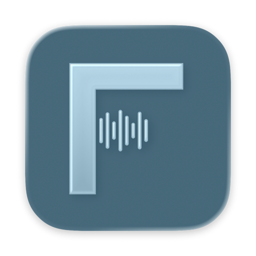

# Fidelia MCP server



Play and explore the music you own in [Fidelia](https://audiofile.engineering/fidelia), an audiophile music player for Mac, from Claude, Codex or any MCP app.

Ask for music the way you'd ask a friend who knows your records: "play some irish trad", "put on that album I got yesterday", "something by Planxty". Fidelia finds it in the music you own (your files, your Music library and any servers you've added) and plays it: a record in track order, a genre or an artist shuffled. When the tags say less than you mean, "Folk" where you mean Irish traditional music, your AI app reads your genres, artists and composers and uses what it knows about the music to choose.

The server is part of Fidelia itself. This repository holds what an AI app needs to reach it: a Claude Desktop extension, a Claude Code plugin, and the setup for other MCP apps.

## What your AI app can and can't do

It can read your whole Fidelia library (titles, artists, albums, genres, composers, years, when you added each one, your playlists, your radio stations and what's playing), play, queue, pause and skip, set the volume, shuffle and repeat, and make playlists or add to them.

It never learns where your files are, and it can't change or delete them. What it reads goes to your AI app's service, under that app's terms.

## What you need

- [Fidelia for Mac](https://apps.apple.com/app/apple-store/id416135376?pt=10877&ct=mcp-github&mt=8) 2.13 or later, on macOS 14 or later.
- Fidelia ▸ Settings ▸ Agent ▸ **Let AI apps use Fidelia** turned on. It's off until you turn it on, and the same page shows your token.
- Playing music needs Fidelia's one-time unlock or its free trial, as it does in the app; music from a server also needs the Network & Server unlock. Reading the library, pausing, the volume and playlists work without them.

## Set it up

### Claude

In Fidelia, open Settings ▸ Agent and click **Make Extension…**. Fidelia saves the extension with your token inside and opens it in Claude, which asks to install it.

Or download `Fidelia.mcpb` from the [latest release](https://github.com/weareaudiofile/fidelia-mcp/releases/latest), open it, and paste the token from Fidelia's Settings ▸ Agent when Claude asks for it.

When Fidelia isn't running, the extension opens it with no window, so asking Claude for music starts it.

### Claude Code

Add this repository as a plugin marketplace and install the plugin. Claude Code asks for two settings: Fidelia's address (keep `http://127.0.0.1:38412/mcp` unless you changed the port) and the token from Fidelia's Settings ▸ Agent:

```text
/plugin install fidelia --marketplace weareaudiofile/fidelia-mcp
```

On Claude Code before 2.1.275, add the marketplace first:

```text
/plugin marketplace add weareaudiofile/fidelia-mcp
/plugin install fidelia@fidelia-mcp
```

Or run one line in Terminal; Settings ▸ Agent shows it with your token already in it:

```bash
claude mcp add --transport http fidelia http://127.0.0.1:38412/mcp --header "Authorization: Bearer YOUR_TOKEN"
```

### Codex

Add this to `~/.codex/config.toml`, then restart Codex. Settings ▸ Agent shows it with your token already in it:

```toml
[mcp_servers.fidelia]
url = "http://127.0.0.1:38412/mcp"
http_headers = { "Authorization" = "Bearer YOUR_TOKEN" }
```

### Other MCP apps

Fidelia serves Streamable HTTP at `http://127.0.0.1:38412/mcp` and wants the header `Authorization: Bearer YOUR_TOKEN`. In an app that takes an `mcpServers` JSON file:

```json
{
  "mcpServers": {
    "fidelia": {
      "url": "http://127.0.0.1:38412/mcp",
      "headers": { "Authorization": "Bearer YOUR_TOKEN" }
    }
  }
}
```

If you change the port in Settings ▸ Agent, change it here too.

## Things to ask

- "Play some irish trad."
- "Put on the album I got yesterday."
- "Queue that Bothy Band record next."
- "What's playing?"
- "Make a playlist of everything I added last month."
- "What's the oldest piece I own, by when it was written? Play it."
- "Play one of my radio stations."

## Tools

| Tool | What it does | |
|---|---|---|
| `search` | Search the library | reads |
| `genres` | List genres | reads |
| `artists` | List artists | reads |
| `composers` | List composers | reads |
| `artists_in_genre` | List a genre's artists | reads |
| `recently_added` | List recently added albums | reads |
| `album_tracks` | List an album's tracks | reads |
| `now_playing` | What's playing | reads |
| `stations` | List radio stations | reads |
| `playlists` | List playlists | reads |
| `playlist_tracks` | List a playlist's tracks | reads |
| `play` | Play | acts |
| `queue` | Add to the queue | acts |
| `pause` | Pause | acts |
| `transport` | Resume or skip | acts |
| `set_volume` | Set the volume | acts |
| `set_shuffle` | Shuffle on or off | acts |
| `set_repeat` | Set repeat | acts |
| `make_playlist` | Make a playlist | acts |
| `add_to_playlist` | Add to a playlist | acts |

Lists come in pages, because a library can run to 100,000 tracks. A page of tracks is grouped by album.

## What's in this repository

- `plugins/fidelia/`: the Claude Code plugin. It runs no code of its own: it connects Claude Code to Fidelia at the address in its settings (`http://127.0.0.1:38412/mcp` unless you changed the port), with your token in the `Authorization` header.
- `server/index.js`: the script inside `Fidelia.mcpb`, which Claude runs with its own Node. It hands each message to Fidelia at 127.0.0.1 with your token and writes back Fidelia's answer. When nothing answers, it opens Fidelia with no window (`open -g -b com.audiofile.fidelia --args -agent.headless YES`) and tries again for up to 45 seconds. It uses only Node's own modules.
- `server.json`: Fidelia's entry in the official MCP Registry.
- `glama/`, `Dockerfile` and `glama.json`: for Glama's automated build check only. Fidelia's server is part of the Fidelia app, so Glama's Linux build machine runs `server/index.js` against a stand-in that lists Fidelia's real tools (`glama/tools.json`, read from Fidelia itself) and answers every call with a note to install Fidelia. People never run these files.

## Privacy and security

- Fidelia listens on 127.0.0.1 only. Nothing on your network or the internet can reach it.
- Only an app with the token from Settings ▸ Agent can connect. **New Token** there turns the old one away at once. A request from a web page is refused.
- The server answers only the AI app you set up. That app sends what it reads to its own AI service, under that app's terms.
- Audiofile's privacy policy: <https://audiofile.engineering/privacy>

## Support

Questions and problems: <https://audiofile.engineering/support>

## License

The files in this repository are under the MIT License. Fidelia itself is Audiofile Engineering's app, on the Mac App Store.
