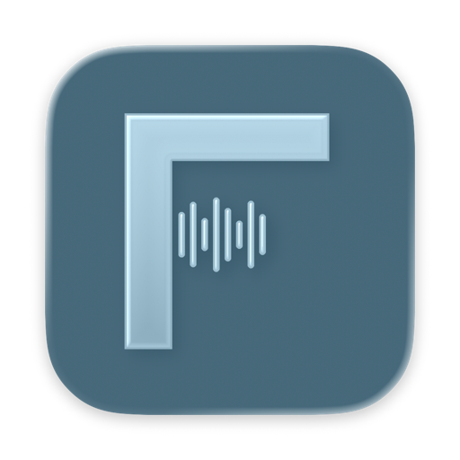

# Fidelia for Claude Code



Play and explore the music you own in [Fidelia](https://audiofile.engineering/fidelia), an audiophile music player for Mac, by asking Claude Code. This plugin adds Fidelia's own MCP server and a skill that teaches Claude how to use it.

## What it runs and where it connects

The plugin runs no code of its own. It connects Claude Code to the address in its **Fidelia address** option, which is `http://127.0.0.1:38412/mcp` unless you changed the port in Fidelia ▸ Settings ▸ Agent: Fidelia itself, on your own Mac. It sends the token from its **Fidelia token** option in the `Authorization` header, and nothing else, anywhere else. Claude Code keeps the token in your system's secure storage.

## What you need

Fidelia for Mac 2.13 or later, with Settings ▸ Agent ▸ **Let AI apps use Fidelia** turned on. The same page shows your token; paste it when Claude Code asks for it.

## Install

In Claude Code:

```text
/plugin install fidelia --marketplace weareaudiofile/fidelia-mcp
```

Claude Code asks for Fidelia's address (keep `http://127.0.0.1:38412/mcp` unless you changed the port) and the token from Fidelia's Settings ▸ Agent.

## Things to ask

- "Play some irish trad."
- "Put on the album I got yesterday."
- "Make a playlist of everything I added last month."

## What Claude can and can't do

Claude can read your Fidelia library (titles, artists, albums, genres, composers, years, when you added each one, your playlists, your radio stations and what's playing), play, queue, pause and skip, set the volume, shuffle and repeat, and make playlists or add to them. It never learns where your files are and can't change or delete them. What it reads goes to Anthropic as part of your conversation, under Claude's terms.

Privacy policy: <https://audiofile.engineering/privacy> · Support: <https://audiofile.engineering/support> · More: <https://github.com/weareaudiofile/fidelia-mcp>
